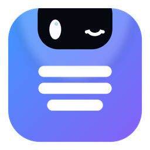

<p align="center"></p>

# Blink

A small notch at the top edge of your screen for the things a student keeps looking for: the next deadline, the song that is playing, the files you are carrying around, and the quick controls (volume, Wi-Fi, brightness). It stays out of the way, shows what matters when you point at it, and uses almost no memory.

**Windows only.** Written in Rust, no web engine in the part that always runs (about 10 MB of memory at rest, 0% CPU when idle). Free, MIT licensed, no account, no analytics.

*Bahasa Indonesia:* Blink adalah "poni" kecil di tepi atas layar Windows: tenggat berikutnya, lagu yang diputar (dengan lirik), file yang sedang kamu bawa, dan kontrol cepat. Gratis, sumber terbuka, tanpa akun, tanpa telemetri. Antarmuka tersedia dalam Bahasa Indonesia dan Inggris.

## What it does

- **Deadlines.** Add a calendar link (Moodle/BRONE, a Google Calendar secret iCal address, or any `.ics` link) and the nearest deadline sits in the notch with a countdown. Click a course to see only that course, snooze a deadline's reminders, mark it done, or turn it into a project.
- **Music.** Whatever plays in Windows (Spotify, a browser tab, any player): title, cover, controls, synced lyrics, bars that move with the sound, and a colour taken from the cover.
- **Shelf.** Drop files on the notch to carry them for a moment, then drag them out onto another app. It also takes what you copied: files, screenshots, text.
- **Projects.** Tasks and files for a project, in one small list.
- **Controls.** Volume, brightness, output device, Wi-Fi, Bluetooth, microphone, cast, lock, screenshot. If you use SteelSeries Sonar, the volume moves Sonar's master.
- **Clock and weather.** Time, the month, and the weather for the city you pick.
- **Peeks.** Short messages for a charger, a low battery, a Bluetooth device, Wi-Fi, volume, brightness, Caps Lock.
- **Yours to shape.** Palettes, accents and pill shapes; gestures (wheel for volume, middle click for play/pause, Shift+wheel or a swipe to turn pages) that can each be switched off; keyboard shortcuts (`Ctrl+Alt+D` opens it, `Ctrl+Alt+H` hides it, `Ctrl+Alt+V` puts the clipboard on the shelf).
- Built for the keyboard and for screen readers too (UI Automation).

## Install

Download `Blink-<version>-setup.exe` from the [Releases](../../releases) page and run it. It installs for you only (no administrator rights).

The installer is **not code-signed yet**, so Windows SmartScreen may say "Windows protected your PC": choose *More info*, then *Run anyway*. Each release lists the file's SHA-256 so you can check what you downloaded:

```powershell
Get-FileHash .\Blink-<version>-setup.exe -Algorithm SHA256
```

Needs Windows 11 (tested) or Windows 10 1809 and later. The settings window uses the Microsoft Edge WebView2 Runtime, which Windows 11 already has; the notch itself does not need it.

## Your data and privacy

Everything stays on your PC. Blink has no account and no analytics. It contacts the internet only for the things you turn on: your calendar links, the weather for the city you chose (Open-Meteo), song lyrics when you ask for them (LRCLIB), and an update check when you press the button. The full list is in [`docs/PRIVACY.md`](docs/PRIVACY.md).

## Build it yourself

You need Rust (MSVC toolchain) with the Visual Studio Build Tools (C++ workload). For the installer, NSIS 3.

```powershell
cargo build --release -p blink-native -p blink-settings    # blink.exe and blink-settings.exe in target\release
cargo test -p blink-native -p blink-core                    # unit and behaviour tests
powershell -File scripts\native\build-release.ps1           # both programs and the installer, with its SHA-256
```

What is where:

- `crates/blink-core`: logic with no windows in it (calendar parsing, planning, feeds, projects, lyrics, weather, updates).
- `crates/blink-native`: the notch (drawing, the window, the pages).
- `crates/blink-settings`: the settings window (Tauri; the pages are plain JavaScript in `src/`).
- `scripts/native`: the checks that drive the real programs (gates, the settings end-to-end run, installer, soak). `docs/RELEASE.md` says what has and has not been verified, and how a release is made.
- `docs/`: plans, release notes and design notes. The first, WebView2-based version is described in `docs/WEBVIEW2-HISTORY.md`.

## Contributing and reporting problems

Open an issue and say what you did, what you expected and what happened; **Settings, General, Copy diagnostics** gives a report with no personal data in it (no feed links, no titles). Pull requests are welcome; run the tests above first.

## License

MIT, see [`LICENSE`](LICENSE). The libraries Blink is built from and their licenses are listed in [`THIRD-PARTY-LICENSES.md`](THIRD-PARTY-LICENSES.md).
